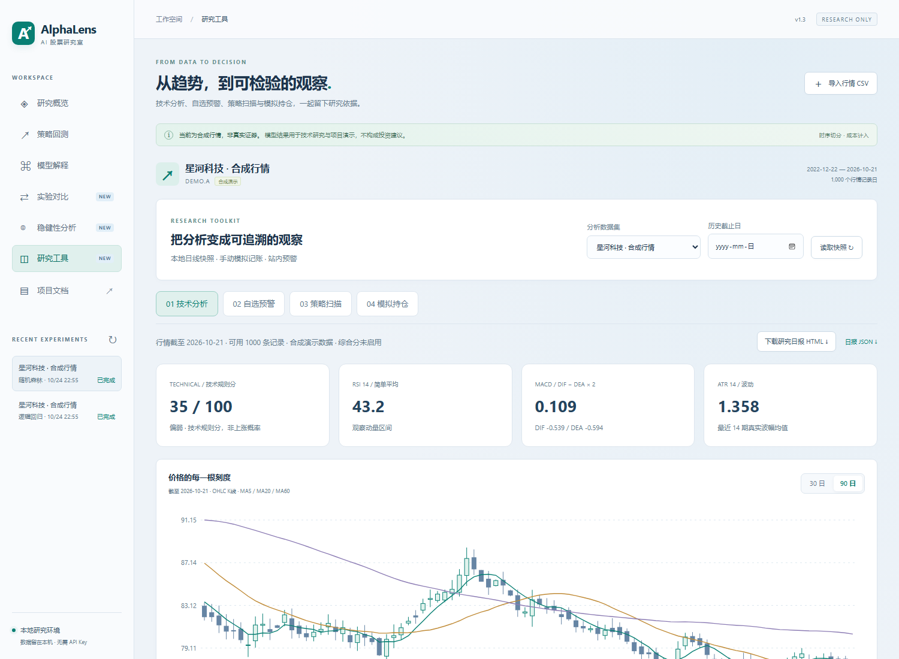
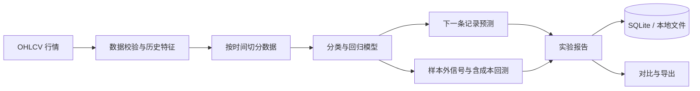

# AlphaLens Stock Lab

**股票趋势预测与可追溯回测研究工作台**


[](https://github.com/keke152/alphalens-stock-lab/actions/workflows/tests.yml)

从日线行情出发，完成特征构建、模型训练、时间顺序评估、含成本回测和实验对比。模型研究的目标是**下一条行情记录的开盘至收盘方向与收益**，实验参数、模型指标和逐日结果均可查看或导出。

[快速开始](#快速开始) · [模型与架构](docs/01-architecture-and-model.md) · [回测口径](docs/02-data-and-backtest.md) · [API 文档](docs/03-api-and-configuration.md)



**v1.3：** 技术K线与指标、自选七类预警、后台快照检查、规则扫描、带仓位风控的模拟账本及研究日报。[功能与演示指南](docs/10-v1.3-toolkit.md)。

**v1.2：** 新增扩展窗口滚动评估、仅验证集阈值选择、成本敏感性、概率诊断和离线 HTML 报告。[查看新功能与操作说明](docs/08-v1.2-research.md)。

## 核心能力

| 模块 | 已实现能力 |
| --- | --- |
| 行情研究 | 3 组可复现合成行情；单标的 OHLCV CSV 导入；区间切换与 MA5 / MA20 |
| 技术研究工具 | K线、MA / MACD / RSI / KDJ / 布林 / ATR、历史截止日、透明技术规则分 |
| 自选与预警 | 七类可配置规则、服务内后台检查、去重事件、已读与 CSV 导出 |
| 规则扫描 | 新高动量六条件、可配置涨幅事件连续次数、未知数据明确标注 |
| 模拟账本 | 手动虚拟买卖、FIFO、较早记录日份额可卖、现金与仓位风险门槛 |
| 研究日报 | 技术快照、自选预警、模拟持仓与当前风控的 HTML / JSON 汇总 |
| 模型训练 | 随机森林、逻辑回归分类方案及配套回归预测 |
| 时间顺序评估 | 单次留出或 3–5 折扩展窗口，每折独立训练，测试资金曲线连续拼接 |
| 阈值与稳健性 | 手动或仅验证集阈值选择、候选追踪、固定信号成本敏感性 |
| 概率与输入诊断 | Brier 分数、可靠性分箱、混淆矩阵、零成交量与价格 / 日期提示 |
| 策略回测 | 入场阈值、手续费与滑点；策略与相同口径基准比较 |
| 结果分析 | 净值、回撤、月度收益、分类与回归指标、特征贡献 |
| 实验管理 | SQLite 持久化、后台任务队列、双模型运行与实验对比 |
| 预测复盘 | 日期与信号筛选、逐日结果查看、含折号与有效阈值的 CSV 导出 |
| 报告交付 | JSON、CSV、独立 HTML，可离线打开并打印为 PDF |

## 研究流程



## 快速开始

建议使用 **Python 3.10 或 3.11**。在 Windows PowerShell 中执行：

```powershell
git clone https://github.com/keke152/alphalens-stock-lab.git
cd alphalens-stock-lab
.\start.bat
```

首次运行自动创建虚拟环境并安装依赖。服务就绪后打开 [研究工作台](http://127.0.0.1:8010)；交互式接口说明见 [API 文档](http://127.0.0.1:8010/docs)。

| 其他启动方式 | 命令 |
| --- | --- |
| PowerShell | `.\start.ps1` |
| macOS / Linux | `sh start.sh --no-browser` |
| Docker Compose | `docker compose up --build` |

各方式的配置、端口和数据保存位置见[使用手册](docs/user-guide.md)。

### 体验一个完整流程

1. 选择一组内置行情，保留默认参数并运行训练与回测。
2. 查看模型的训练时间边界、样本外指标、净值与回撤。
3. 在相同数据和参数下运行两种模型，比较实验结果。
4. 选择扩展窗口评估和验证集阈值，打开稳健性分析查看各折时间边界与候选表。
5. 观察成本情景、概率分箱和数据检查，下载离线 HTML 报告用于演示。
6. 打开“研究工具”，切换技术指标、配置自选预警、扫描规则，并记录虚拟资金成交。
7. 下载研究日报，结合数据覆盖率与模拟风控说明完整研究过程。

## 文档与示例

| 文档 | 内容 |
| --- | --- |
| [使用手册](docs/user-guide.md) | 安装、操作、CSV 格式与数据迁移 |
| [架构与模型](docs/01-architecture-and-model.md) | 特征、模型、时间切分与信息泄漏防护 |
| [数据与回测](docs/02-data-and-backtest.md) | 收益目标、成本、执行假设与基准 |
| [API 与配置](docs/03-api-and-configuration.md) | 接口、参数和常见问题 |
| [演示与技术讲解](docs/04-demo-and-interview.md) | 演示流程、技术决策与问答 |
| [扩展路线](docs/05-roadmap.md) | 滚动评估、市场适配与工程化 |
| [v1.1 更新说明](docs/07-v1.1-update.md) | 界面、行情视图、复盘和实验对比 |
| [v1.3 研究工具](docs/10-v1.3-toolkit.md) | 指标、自选预警、扫描、模拟账本和日报 |
| [v1.3 验证](docs/11-v1.3-validation.md) | 52项用例与浏览器实际流程 |
| [研究日报示例](examples/daily-review.html) | 基于合成行情和虚拟账本的离线日报 |
| [v1.2 滚动研究](docs/08-v1.2-research.md) | 时间边界、阈值候选、诊断及离线报告 |
| [验证记录](docs/09-validation.md) | 自动化、真实 HTTP 与浏览器检查 |
| [滚动报告示例](examples/walk-forward-report.html) | 可离线打开并打印的真实合成行情研究结果 |
| [示例报告](examples/demo-report.json) | 基于演示数据计算的报告结构与结果 |

## 项目结构

```text
alphalens-stock-lab/
├── app/                  # API、数据处理、模型与任务存储
├── static/               # 浏览器研究工作台
├── data/                 # 合成日线数据
├── examples/             # 示例报告与模型文件
├── docs/                 # 架构、口径、操作与研究说明
├── tests/                # 计算边界、时间隔离、报告及实际 HTTP 检查
├── .github/workflows/    # Python 与 JavaScript 持续集成
├── start.bat             # Windows 启动入口
├── Dockerfile            # 可选容器部署
└── compose.yaml          # 本机容器配置
```

## 自动化检查

安装 `requirements.txt` 后运行：

```text
python -m unittest discover -s tests -v
```

本次本机运行 52 项通过；在原有时间隔离与回测检查外，新增指标预热、七类预警、重复事件、FIFO / T+1、并发幂等、仓位限制及研究日报检查。浏览器流程与范围见 [v1.3验证记录](docs/11-v1.3-validation.md)。

## 研究边界

- 模型执行真实训练，默认行情是合成数据；样例指标不能外推为真实市场表现。
- 上涨分数未经概率校准。最新预测沿用最后一折训练模型与实际阈值，不会自动用全量历史重训。
- 回测使用「下一条记录开盘买入、当日收盘卖出」及同口径基准；没有完整模拟停牌、涨跌停、盘口和市场税费，也不能直接适用于普通 A 股 T+1 现货交易。
- 当前是本地单用户研究应用，使用本地日线与手动虚拟账本；资金流、财务、新闻、情绪及真实行情源未接入，综合评分留空。
- 模拟账本的较早记录日份额可卖与仓位门槛，不等于已完整实现真实市场执行规则；原机器学习回测仍使用日内开平仓假设。

详细假设见[数据与回测说明](docs/02-data-and-backtest.md)。本项目以 [MIT License](LICENSE) 发布。
