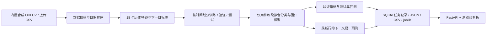

# 架构与模型原理

## 1. 系统结构



| 模块 | 实现位置 | 职责 |
| --- | --- | --- |
| 行情数据 | `app/data.py` | 固定种子合成行情、CSV 解码、字段与 OHLC 校验 |
| 评估计算 | `app/evaluation.py` | 时间窗口、验证阈值、统一回测与诊断 |
| 离线报告 | `app/reporting.py` | 转义用户文本，生成独立可打印 HTML |
| 研究引擎 | `app/engine.py` | 特征、时间切分、训练、指标、回测、模型保存 |
| 技术分析 | `app/technical.py` | 因果日线指标、技术规则分、六条件扫描 |
| 自选与监控 | `app/watching.py` | 七类规则、去重事件、可停止后台线程 |
| 模拟账本 | `app/paper.py` | FIFO、可卖数量、现金与仓位检查、资产历史 |
| 工具接口 | `app/tools_api.py` | 技术、自选、扫描、模拟账本与日报 API |
| HTTP 服务 | `app/main.py` | 上传、后台任务、报告、模型、文档和静态页面接口 |
| 本地存储 | `app/storage.py` | SQLite 数据集及任务元数据、报告和模型路径 |
| 命令行 | `app/cli.py` | 生成行情、从 CSV 训练并保存报告 |
| 启动入口 | `app/launch.py` | 启动本机服务与浏览器 |
| 前端 | `static/` | 数据集与参数选择、图表、任务历史、导出 |

训练使用一个后台工作线程，HTTP 请求可查询任务进展。SQLite 保存任务状态；体积较大的数据、报告和模型作为文件存储，数据库保存引用。

## 2. 预测目标必须先定义

记第 t 条日线的开盘价为 `O_t`，收盘价为 `C_t`。

```text
特征生成时点：第 t 天收盘后
回归目标：y_return_t = C_(t+1) / O_(t+1) - 1
分类目标：y_direction_t = 1(y_return_t > 0)
```

这里预测的是**下一条有效行情记录的开盘至收盘收益**，不是“明天收盘相对今天收盘的涨幅”，也不是未来某个准确价格。平盘归为非上涨类。用户导入的数据应按实际交易日完整排列；服务不自动补齐交易日历。

```text
t 日开盘 ── t 日收盘：得到完整 OHLCV → 计算 X_t、输出分数
                                             │
                                             ▼
t+1 日开盘：按信号进入 ───────── t+1 日收盘：退出并计算标签
```

最新一行只有特征，没有下一交易日真实标签；其预测不会被计入历史指标。

## 3. 18 个特征

所有窗口包含当前行，但不读取当前行之后的行情。前 20 行用于滚动特征预热，不进入训练样本。

| 特征名 | 含义与计算 |
| --- | --- |
| `return_1 / 2 / 5 / 10 / 20` | `C_t / C_(t-k) - 1`，共 5 个收盘收益特征 |
| `overnight_gap` | `O_t / C_(t-1) - 1`，当日开盘缺口 |
| `intraday_return` | `C_t / O_t - 1`，当日日内收益 |
| `range_ratio` | `(H_t - L_t) / C_t`，当日振幅 |
| `close_position` | `(C_t - L_t) / (H_t - L_t)`；高低价相同时置 0.5 |
| `ma_gap_5 / 20` | `C_t / mean(C, k) - 1`，均线偏离，共 2 个 |
| `volatility_5 / 20` | 最近 k 个单日收盘收益的样本标准差，共 2 个 |
| `volume_ratio_5 / 20` | `(V_t + 1) / (mean(V, k) + 1) - 1`，共 2 个 |
| `volume_log_change` | `log(1 + V_t) - log(1 + V_(t-1))` |
| `rsi_14` | 最近 14 日上涨额均值 /（上涨额均值 + 下跌额绝对值均值），范围 0–1；全平置 0.5 |
| `trend_strength` | `return_5 / (volatility_20 × sqrt(5) + 1e-8)` |

`rsi_14` 使用简单滚动均值并缩放至 0–1，不是采用 Wilder 平滑的 0–100 RSI 实现。成交量加 1 是为了处理合法零成交量，未用未来值回填。

## 4. 两组模型

| 界面选择 | 分类器 | 回归器 | 核心设置 |
| --- | --- | --- | --- |
| 随机森林 | `RandomForestClassifier` | `RandomForestRegressor` | 各 180 棵树，深度上限 6，叶子最少 6 个样本 |
| 逻辑回归 | `StandardScaler → LogisticRegression` | `StandardScaler → Ridge` | 分类 `C=1.0`，回归 `alpha=10.0` |

分类输出 `probability_up`，回归输出 `predicted_return`。交易信号只使用分类分数；回归结果用于研究展示与误差评估。随机森林使用固定随机种子，默认 42；数据生成另有各标的自己的固定种子，两者作用不同。

逻辑回归与 Ridge 的标准化器放在 Pipeline 中，只用训练段拟合均值与方差。随机森林不做标准化。本版没有自动超参数搜索、概率校准或在线学习。

随机森林分类分数由各树的正类概率平均得到。它是模型输出，不能直接等同于未来交易的真实获利概率。参见 [scikit-learn RandomForestClassifier](https://scikit-learn.org/stable/modules/generated/sklearn.ensemble.RandomForestClassifier.html)。

## 5. 时间划分与隔离

默认单次留出：去掉 20 行预热和最后一行未知标签后，设可用样本数为 `N`：

```text
train_stop = floor(0.60 × N)
validation_stop = floor(0.80 × N)

训练：     [0, train_stop)
隔离：     train_stop 这一行
验证：     [train_stop + 1, validation_stop)
隔离：     validation_stop 这一行
测试：     [validation_stop + 1, N)
```

区间使用左闭右开写法。因为各边界排除一行，实际比例近似 60% / 20% / 20%。每段报告同时保留特征 / 信号日期范围和目标 / 执行日期范围，避免把两种日期混淆。

一行隔离对应当前“下一行”标签跨度：上一段末行的目标日早于下一段第一条信号日。若未来将标签改成 5 日收益，应重新设计隔离长度和重叠处理，不能继续机械地保留一行。

v1.2 另支持 3–5 折扩展窗口，测试日期连续且不重叠，每折独立重新拟合模型。详细索引及跨折复利方式见 [滚动评估说明](08-v1.2-research.md)。

### 本版如何使用三段数据

- **训练段：** 拟合模型和标准化器。
- **验证段：** 报告方向指标与收益误差；选择自动阈值模式时，仅用该段含成本收益选择交易阈值。不会自动选择模型或模型超参数。
- **测试段：** 生成最终指标、逐日预测与回测曲线。

特征是整段数据上按因果方向计算的滚动结果，较后样本可以使用其之前的历史行情。这不会使其反过来影响训练段。关键条件是所有特征窗口都向过去取值，预处理的统计量只在训练集拟合。数据泄漏原则可参考 [scikit-learn 常见陷阱](https://scikit-learn.org/stable/common_pitfalls.html) 与 [滞后特征时间序列示例](https://scikit-learn.org/stable/auto_examples/applications/plot_time_series_lagged_features.html)。

### 仍需避免的人为泄漏

反复查看同一测试段表现后调整模型和阈值，会把测试段变成事实上的调参集。该软件提供对比能力，不代表这种反复选择仍有独立样本外意义。正式研究应冻结方案，再使用未看过的数据评估。

## 6. 最新预测与特征贡献

最新预测沿用最后一折训练段拟合的模型及有效阈值，不在实验结束后使用全量数据重训。`latest.as_of` 是最新行情日期，`latest.model_train_end` 是训练标签最后可得日期，两者都需要一起理解。

特征贡献的含义取决于模型：

- 随机森林显示分类器的 impurity-based feature importance。
- 逻辑回归显示标准化特征系数绝对值，再归一化到总和为 1。

两者都只表示模型内部关联，不能证明某个指标导致了股价变化；不同模型的重要性数值不宜直接横向比较。当前没有实现 SHAP 或独立留出集的 permutation importance。

## 7. 可追溯输出

完整 JSON 报告包含数据摘要、参数、切分日期、模型信息、验证与测试指标、最新预测、逐日记录、说明文字，以及输入数据摘要和版本信息。joblib 文件包含最后一折分类器、回归器、特征顺序、原始配置、有效阈值和训练范围。新报告另含每折候选阈值、成本情景、概率诊断及数据质量；CSV 含逐行折号与阈值。

网页历史任务记录“哪份数据、什么参数、何时执行、当前状态”；数据文件、报告和模型保存在本机。当前不支持跨版本模型兼容保证或完整实验平台的自动模型注册。
