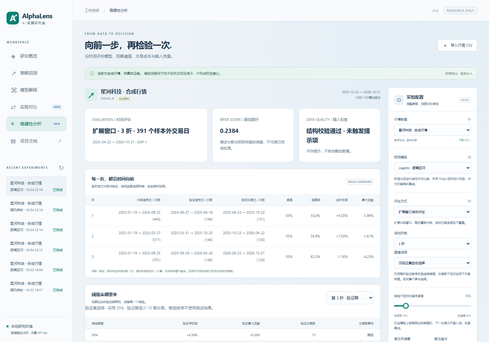

# v1.2：滚动评估与稳健性研究

v1.2 增加扩展窗口评估、验证集阈值选择、成本敏感性、概率诊断、数据检查与可打印报告。预测目标仍为下一条行情记录的开盘至收盘方向与收益，背景使用浅灰蓝色。



## 1. 页面操作

1. 在实验配置中选择数据集和模型。
2. 评估方式选“扩展窗口滚动评估”，选择 3、4 或 5 折。
3. 阈值方式选“仅验证集自动选择”，下方滑杆作为候选交易数不足时的备用阈值；也可选择手动固定。
4. 训练完成后进入“稳健性分析”，查看完整时间边界、每折指标与阈值候选。
5. 查看固定原信号下的 0 / 0.5 / 1 / 1.5 / 2 倍交易成本情景。
6. 从报告底部下载 HTML，离线打开后使用浏览器“打印 → 保存为 PDF”。JSON / CSV 保留完整逐日结果。

旧实验继续可读。在稳健性页面会提示重新训练；不会为旧报告补造候选结果。新报告的 `report_version` 为 2。数据指纹使用固定 UTF-8 / CRLF / `%.10g` 浮点序列化，避免操作系统默认换行影响摘要。

## 2. 扩展窗口如何划分

先移除 20 行特征预热与最后一行未知未来标签，剩余样本数记为 `N`。

```text
first_test = floor(0.60 × N) + 1
validation_rows = max(20, floor(0.15 × N))
```

将 `[first_test, N)` 分成指定数量的连续测试块。每折以测试块起点 `s` 定义：

```text
训练： [0, s - validation_rows - 2)
隔离： s - validation_rows - 2
验证： [s - validation_rows - 1, s - 1)
隔离： s - 1
测试： 当前连续测试块
```

区间左闭右开；训练从第一条有效样本开始，随时间扩展，验证窗口长度固定。每折重新创建并拟合模型，Pipeline 标准化器只拟合该折训练数据。测试块不重复、不重叠；净值按真实日期连续复利，跨折不重置资金。

后续折可使用当时已经发生的历史数据，包括此前折的测试记录。这符合向前推进的评估方式；不允许未来折反过来改变过去已经记录的预测。

主界面训练时间条展示**最后一折**，主指标覆盖**所有折拼接的测试期**。完整各折边界在稳健性页面和 `evaluation.folds` 中。每折表内收益单独以 1 为起点，不能简单相加得到全程收益。

默认“单次时间留出”继续按约 60% / 20% / 20% 划分。两种评估方式的测试日期通常不同，实验对比会据数据指纹和完整日期序列判断是否允许叠加净值。

## 3. 验证集阈值选择

候选为 `0.50, 0.55, …, 0.90`，并加入手动配置的阈值，排序去重。每个候选用该折验证期预测和真实日内收益计算**含成本累计净收益**。

```text
minimum_trades = max(5, ceil(验证样本行数 × 0.10))
```

自动模式从满足最低交易数的候选中选择验证收益最高者；收益相同取较低阈值。全部候选不满足时使用手动备用值，并在报告标记 `fallback: true`。手动模式使用指定阈值，候选表只作展示。

选好阈值后再对该折测试期应用，不读取测试标签选择参数。新 CSV 每行含 `fold` 和 `threshold`，模型文件保存 `effective_threshold`，最新预测使用最后一折实际阈值。

验证期较短、候选反复比较仍可能过拟合。滚动评估不会自动消除模型选择偏差。反复根据最终测试表现修改方案后，应再用未看过的数据评估。

## 4. 成本与概率诊断

成本情景将手续费、滑点同时乘以指定倍数，**固定原预测、每折阈值和交易日**，只重新计算净收益。不会按压力情景重新调阈值，也不会自动采用测试期表现最好的费用设置。

方向分类以 0.5 为界，平盘属于非上涨。混淆矩阵列出 TN / FP / FN / TP。Brier 分数计算为：

```text
Brier = mean((probability_up - actual_up_label)²)
```

可靠性表把样本外分数按五个区间分组，比较平均分数与实际上涨比例。前四个区间左闭右开，最后一个含 1；空区间显示为空。这里是描述性诊断，**没有对模型输出执行概率校准**。小样本区间的比例不宜过度解读。

## 5. 数据质量检查

结构校验仍拒绝重复日期、缺失值、非有限数字和不一致的 OHLC。新提示项为：

| 检查 | 用途 |
| --- | --- |
| 零成交量 | 提醒核对停牌、缺失成交量与可成交假设 |
| 相邻收盘变化绝对值超过 20% | 提醒核对复权、公司行动或异常价格 |
| 相邻日期间隔超过 7 个自然日 | 提醒核对节假日、停牌或缺失记录 |

提示对整份输入文件计算，只作描述，不删除、填补记录，也不参与训练或阈值选择。没有接入特定市场交易日历，间隔较长不直接等于数据错误。

## 6. 报告和复现

HTML 自带样式及 SVG 净值图，无 CDN、外部图片或脚本依赖；用户文本经过 HTML 转义。可通过浏览器打印保存为 PDF。HTML 展示最近 30 条预测，完整逐日数据请使用 JSON / CSV。

```powershell
python -m app.cli train --csv data/demo-a.csv --model logistic `
  --evaluation walk_forward --folds 3 --threshold-mode validation `
  --source synthetic --name "滚动研究示例" `
  --output report.json --html report.html --save-model model.joblib
```

项目内提供真实计算的 [JSON 示例](../examples/walk-forward-report.json) 和 [离线报告](../examples/walk-forward-report.html)。示例使用合成行情，不能解释为真实证券表现。模型文件只保存最后一折训练模型，不是全量重训模型。

自动化用例和浏览器操作记录见 [v1.2 验证记录](09-validation.md)。

参考：[scikit-learn 时间序列划分](https://scikit-learn.org/stable/modules/generated/sklearn.model_selection.TimeSeriesSplit.html)、[Brier 分数](https://scikit-learn.org/stable/modules/generated/sklearn.metrics.brier_score_loss.html)。本项目为同时表达独立验证窗口及两个隔离边界，使用 `app/evaluation.py` 中的显式索引划分。
