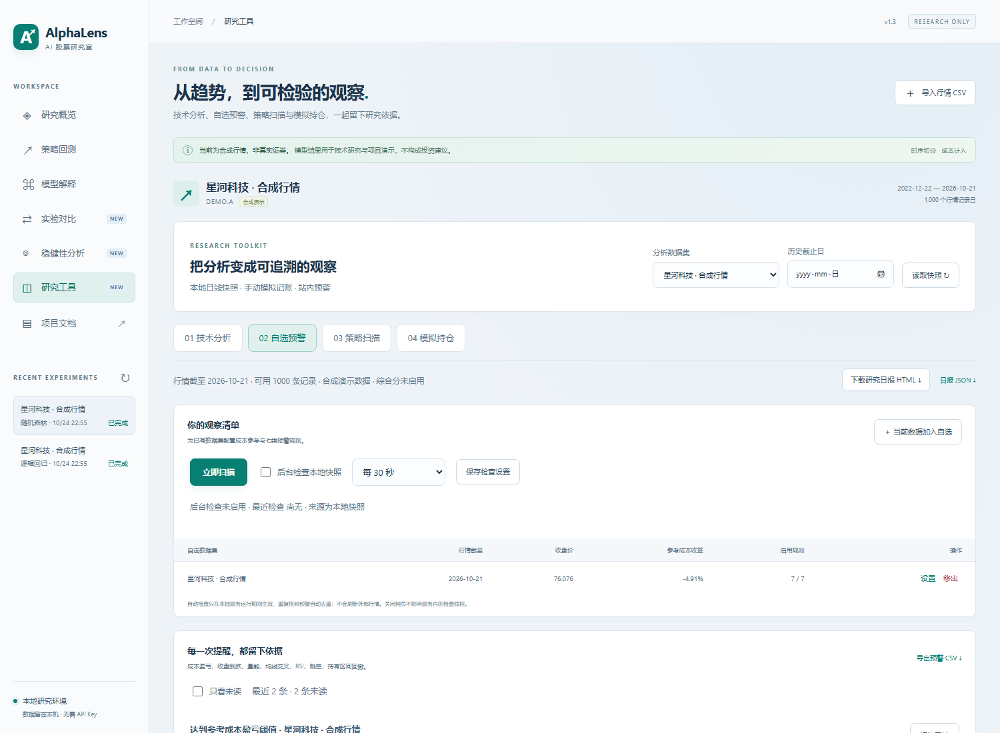
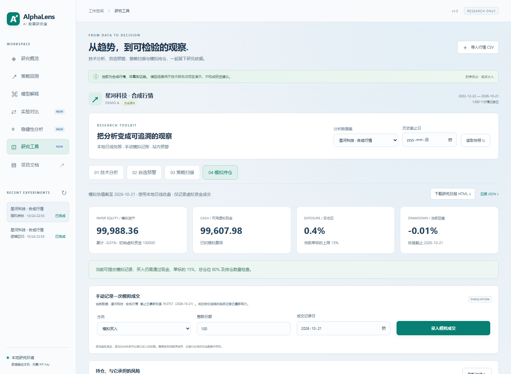
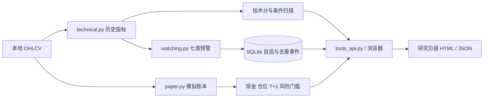

# v1.3：技术研究、自选预警与模拟持仓

本次参考提供的功能图片，新增“研究工具”入口，覆盖技术分析、自选预警、策略扫描、模拟持仓及研究日报。原有机器学习预测、滚动评估、含成本回测与报告继续使用。

## 1. 功能对应关系

| 图片中的方向 | 当前实现 |
| --- | --- |
| K线、均线和技术指标 | 日线 K线，MA5 / 10 / 20 / 60、MACD、RSI、KDJ、布林带、ATR |
| 多维评分 | 已计算透明技术规则分；展示五维权重与数据覆盖率，缺失维度留空 |
| 七类股票预警 | 成本、收盘涨跌、成交量、MA交叉、RSI、跳空、区间回撤，可逐项启用 |
| 后台监控 | 服务内线程定期检查本地快照，持久化规则、去重事件、已读状态 |
| 新高动量策略 | 指定回看期的新高、均线、量能、RSI、同日参考指数、模拟持仓状态六条件扫描 |
| 连板研究 | 可配置涨幅事件阈值并统计连续次数；明确未建模交易所涨停、封单和晋级概率 |
| 仓位、止损和系统风控 | 虚拟账本、FIFO、较早记录日份额可卖、仓位限制、风险暂停与参考线提醒 |
| 收盘复盘 | 下载 HTML / JSON 日报，包含技术快照、自选、预警、模拟持仓和当前风控参数 |
| 多家行情源 / 资金流 / 新闻 | 当前使用本地 CSV 与合成数据；其余维度显示未接入 |
| 自动实盘 / 可转债 T+0 / 外部消息 | 当前使用手动模拟记账和站内预警；未实现这些连接 |

图片中的外部脚本、服务名称及策略参数是参考资料，本项目没有安装或宣称集成其私有工具。技术规则分不等于机器学习上涨概率，两者在界面和数据结构中分开显示。

## 2. 三分钟演示

1. 打开“研究工具 → 技术分析”，选择数据集，切换 K线条数与指标类型。
2. 设置历史截止日，检查页面显示的有效行情日期；技术分析只使用该日及以前的数据。
3. 打开“自选预警”，添加当前数据，设置参考成本、成本起始日和规则阈值，执行立即扫描。
4. 再次扫描相同快照，确认新增预警为 0；可将提醒标为已读。
5. 在“策略扫描”选择参考指数数据集并扫描，展开条件明细，解释未知数据与未满足条件的区别。
6. 在“模拟持仓”选择倒数第二个行情日，手动模拟买入少量份额；同日卖出会被阻止，下一条更晚记录日可卖出。
7. 下载研究日报 HTML，离线打开或打印为 PDF。完整状态可下载 JSON，账本和预警另有 CSV。

所有操作使用本地快照；“后台检查”不会从外部平台下载新行情。需要更新行情时导入新的 CSV。自选项绑定数据集 ID，导入新文件后应选择新的数据集并设置自选。

## 3. 技术指标口径

指标先在截止日前全部可用记录上计算，再截取最近 250 条用于展示。因此 30 / 90 条视图仍可使用更早历史计算均线。

| 指标 | 实现 |
| --- | --- |
| MA | 最近 N 条收盘的简单平均，N=5/10/20/60 |
| RSI14 | 最近14期上涨额均值 / 上涨额与下跌额绝对值均值之和 ×100；全平为50 |
| MACD | DIF=EMA12−EMA26，DEA=EMA9(DIF)，差值线=2×(DIF−DEA)；EMA `adjust=False`，以第一条观察值初始化，26条后显示 |
| KDJ | 9期高低区间 RSV；K、D 初值50，递推权重2/3与1/3；J=3K−2D，允许超出0–100 |
| 布林带 | MA20 ±2×20期总体标准差（ddof=0） |
| ATR14 | TR为当日高低差、最高与前收盘差绝对值、最低与前收盘差绝对值的最大值；14期简单平均 |
| 量比 | 当前成交量 / 此前20期成交量均值，分母不含当期；分母0时为空 |

RSI 与 ATR 使用简单平均，可能与 Wilder 平滑版本不同。没有足够预热数据时显示空值。参考：[StockCharts 指标说明](https://chartschool.stockcharts.com/table-of-contents/technical-indicators-and-overlays)、[布林带公式](https://chartschool.stockcharts.com/table-of-contents/technical-indicators-and-overlays/technical-overlays/bollinger-bands)。

## 4. 技术规则分与缺失维度

技术分由下列五项组成，满足则获得该项权重，否则为0。任一项数据不足时不生成完整技术分。

| 规则 | 分值 |
| --- | --- |
| 收盘 > MA20 > MA60 | 25 |
| 45 ≤ RSI14 ≤ 70 | 20 |
| DIF > DEA | 20 |
| ATR14 / 收盘 < 4% | 15 |
| 1 ≤ 量比 ≤ 3 | 20 |

≥70显示偏强，40–69显示中性，<40显示偏弱。这是可复现的规则描述，未经收益效果验证，不表示交易指令。

沿用参考资料的五维权重展示：技术25%、资金30%、基本面10%、消息20%、情绪15%。当前只有技术数据，覆盖率为25%，`overall_score` 始终为 `null`。不能把缺失维度算零后称为综合评分，也不能用成交量替代真实主力资金净流入。

## 5. 自选预警与后台检查

| 规则 | 默认值与说明 |
| --- | --- |
| 成本盈亏 | 收盘 / 参考成本 −1，达到 +15% 或 −12%；不含交易费用 |
| 收盘涨跌 | 相对上一条收盘变化绝对值 ≥4%，不等于当日开盘至收盘收益 |
| 成交量 | 当前量 / 此前20期均量 ≥2 或 ≤0.5 |
| 均线交叉 | MA5 从不高于 MA10 变为高于，或从不低于变为低于 |
| RSI | 简单平均 RSI14 ≥70 或 ≤30 |
| 跳空 | 开盘 / 前收盘 −1 的绝对值 ≥1% |
| 区间回撤 | 成本起始日以来最高收盘曾较成本上涨10%，当前从该峰值回撤至少5% |

参考成本未提供时，成本及区间回撤规则跳过；截止日早于成本起始日时，同样跳过。其余规则正常计算。默认成本起始日为数据集最新行情日期，可手动修改。

每条事件按数据集、数据摘要、有效行情日、规则参数、参考成本和事件类型生成去重 ID。重复快照不重复提醒；规则或参考成本变化后，新匹配事件可另行记录。已读状态持久化。移出自选不会删除预警历史。

后台检查默认关闭，配置后在本地服务运行期间每30–3600秒检查最新快照。它不自动运行系统任务，也不保证电脑休眠、程序关闭期间继续工作。服务重启后恢复启用配置；没有变化的快照通过去重避免重复事件。提醒仅保存在站内，未发送飞书、微信或邮件。

## 6. 策略扫描

新高动量模板检查六项：

1. 收盘严格高于此前 `lookback` 条最高收盘，当前记录不计入参考最高值。
2. MA5 > MA20，且收盘高于两条均线。
3. 量比 ≥配置值，默认1.5。
4. RSI14 <配置上限，默认85。
5. 参考指数存在同日数据，且收盘 >其MA20。
6. 模拟账本未持有，且未处于系统暂停。

缺少历史或同日参考指数时，条件显示未知，不算通过。参考指数由用户选择已导入数据集；选择合成数据只是在验证流程，不代表已经接入某真实指数。历史扫描会过滤截止日以后的模拟成交记录。

涨幅事件默认10%，可改5% / 20% / 30%。连续次数按收盘相对上一条收盘是否达到阈值统计。它不判断真实涨停价、不处理不同板块/ST/上市初期规则、不提供封单与晋级预测。

## 7. 模拟账本与风险门槛

账本初始虚拟资金为100000，用户手动选择数据集、方向、整数份额和记录日。执行价为该日收盘按滑点调整，手续费按成交额收取；默认单边5bps手续费与2bps滑点。买入成本含费用，卖出按FIFO扣减更早记录日的份额。

同日新增份额不可卖。这个限制只实现了“较早记录日份额可卖”，没有完整模拟真实A股交易规则：最小交易单位、停牌拒单、涨跌停无法成交、实际市场税费、复权持仓调整等仍需额外建模。所有价格视为同一虚拟计价单位，不处理跨币种资产。

买入检查：现金充足、最大持仓数、单标的上限、总仓位上限和系统暂停。默认单标的20%、总仓位80%、最多5个标的。仓位分母使用买入后、扣费用与滑点损耗的模拟资产；同一标的加仓也累计检查。

风险规则：

- 当前资产首次从回撤线以上跌到默认−15%及以下，暂停5个已观察行情记录日（包含触发日）。持续低于阈值不会每天重新触发一轮；恢复后再次跌破会重新触发。
- 当前估值记录日资产日收益≤默认−5%，阻止该记录日新增买入。
- 连续3个资产记录日亏损，单标的上限减半；非亏损记录中断连续计数。
- 默认单标的−8%参考止损、+15%参考止盈、盈利曾达10%后从最高收盘回撤5%，生成持仓提示。

风险提示不会自动卖出或清仓；用户手动模拟卖出仍受可卖数量限制。停止买入不等于损失已经被控制，参数仅用于演示约束如何进入系统。

账本只允许按时间顺序添加成交。每个客户端请求 ID 只记账一次，SQLite `BEGIN IMMEDIATE` 保护并发检查与入账。全量成交最多2000笔，页面显示最近200笔，CSV导出全部。历史估值由成交与截止日前已有收盘重建，不使用未来价格回填。参考持仓峰值从最早剩余批次买入日开始计算，减仓后峰值起点可能改变。

## 8. 研究日报

入口位于工具页顶部，提供 HTML 和 JSON。报告包含所选标的的技术指标、数据覆盖率、当前自选清单、截止日前已保存预警、按截止日前成交重建的模拟持仓与当前风控参数。

历史截止日只过滤行情、预警和成交；自选规则与风险参数使用当前配置，不宣称复原当时的原始配置。报告是描述性快照，不自动生成新闻观点、收益承诺或买卖建议。

HTML 使用内置样式，没有外部脚本和字体依赖，可离线打开并用浏览器打印为PDF。实际演示输出见 [研究日报示例](../examples/daily-review.html) / [JSON](../examples/daily-review.json)。

## 9. 代码与验证

接口详见 [API说明](03-api-and-configuration.md)，本次实际测试与浏览器记录见 [v1.3验证记录](11-v1.3-validation.md)。
