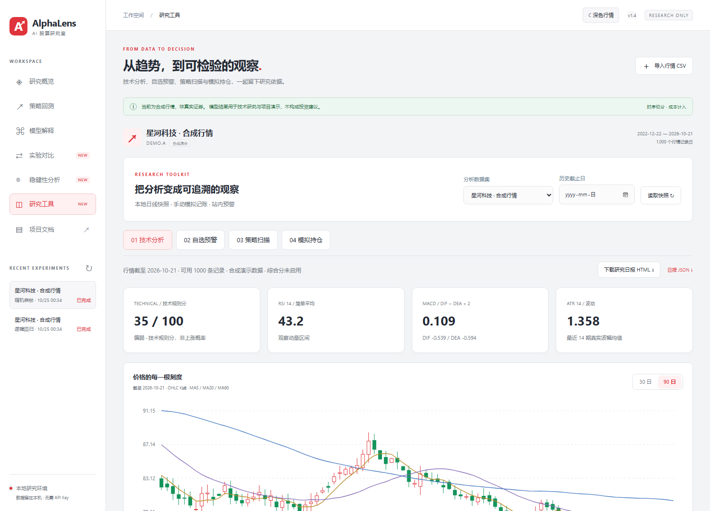
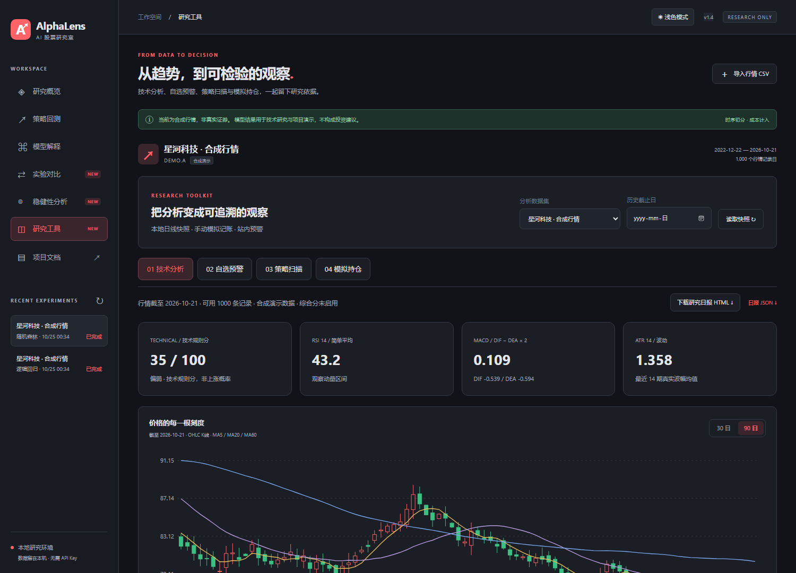

# v1.4：Windows桌面版与行情主题

## 直接启动

下载交付的Windows压缩包，解压后双击 `AlphaLens.exe`。也可以将这个EXE复制到桌面，直接双击使用。

桌面版使用独立应用窗口，内置Python、FastAPI、NumPy、pandas与scikit-learn，日常使用无需另装Python或打开命令行。首次启动需要解压内置资源，可能比后续启动慢一些。

适用Windows10/11的64位系统，需要Microsoft Edge WebView2 Runtime；本次交付机器已安装。若其他电脑缺少该组件，可从[微软官方页面](https://developer.microsoft.com/microsoft-edge/webview2/)安装。

## 界面配色

根据同花顺配色方向调整为灰白背景、红色强调，仍使用AlphaLens名称与图标。右上角“深色行情 / 浅色模式”可切换主题。正收益和上涨使用红色，负收益和下跌使用绿色；主题选择保存在本机。





网页模式和桌面模式均支持这两个主题。桌面应用为避免端口冲突自动选择空闲本机端口，主题偏好使用本地浏览器配置保存，可跨桌面启动继续使用。

## 数据与日志

桌面版的默认数据目录：

```text
%USERPROFILE%\Documents\AlphaLensStockLab\user-data
```

其中 `research.sqlite3` 是实验、自选、预警和模拟账本索引；`datasets/`、`reports/`、`models/`分别保存行情、报告和模型；`webview/`保存桌面窗口配置。日志位于 `logs/desktop.log`。

EXE中的资源目录仅用来读取程序和示例，用户数据保存在上述目录。更新时关闭应用并替换EXE即可，数据目录继续沿用。备份时应在关闭桌面版后复制整个 `user-data` 目录。

源码网页模式继续默认使用项目内 `runtime/`。两个目录独立。已有网页实验可在关闭相关服务后将运行目录完整迁移，并同步SQLite内的文件路径；本次本机交付会在桌面目录尚无数据库时复制已有运行数据，原目录保留。其他电脑使用全新的默认工作目录。

需要指定另一目录时，可执行：

```powershell
.\AlphaLens.exe --data-dir "D:\MyStockResearch"
```

同一个数据目录只允许一个桌面实例，重复启动会尝试切回已有窗口。关闭桌面窗口会停止它自己的本地服务和监控线程；原网页模式的8010服务独立运行。

## 文件导出与导入

原有CSV导入、自选预警、模拟账本、模型训练、滚动评估和报告仍可使用。点击导出链接时，桌面窗口会弹出系统保存文件对话框。HTML报告保存后可在浏览器中打开并打印为PDF。

桌面版仍使用已有本地快照。Windows EXE打包不会自动接入实时行情、资金流、新闻或券商，也不会改变模拟账本的执行假设。

## 从源码构建

在Windows的Python3.10环境中执行：

```powershell
python -m pip install -r requirements-desktop.txt
python -m PyInstaller --noconfirm AlphaLens.spec
```

生成文件为 `dist/AlphaLens.exe`。也可运行 `build-desktop.ps1 -InstallDependencies`。PyInstaller按当前平台构建，Linux持续检查只验证应用代码，不生成Windows可执行文件。

打包入口为 `desktop_launcher.py` 和 `app/desktop.py`；`AlphaLens.spec`收集静态页面、示例、文档及模型运行依赖，`assets/`包含图标与Windows版本信息。Windows窗口使用pywebview与WebView2，API仅绑定127.0.0.1。

参考：[pywebview打包说明](https://pywebview.flowrl.com/guide/freezing.html)、[PyInstaller运行路径说明](https://pyinstaller.org/en/stable/runtime-information.html)。

## 本次验证

- Windows源码自动化55项通过，含冻结环境数据路径及重复实例锁。
- 灰白 / 深色切换、刷新后主题保留及390像素布局检查通过。
- 实际EXE在与源码不同的工作目录、含中文与空格的数据路径下运行；测试进程PATH不包含Python目录。
- EXE实际加载原生WebView、运行指标与真实模型训练；最终打包检查结果随交付说明记录。

桌面窗口与模型运行在本机Windows验证，未声称已覆盖所有Windows版本和其他电脑的环境差异。
